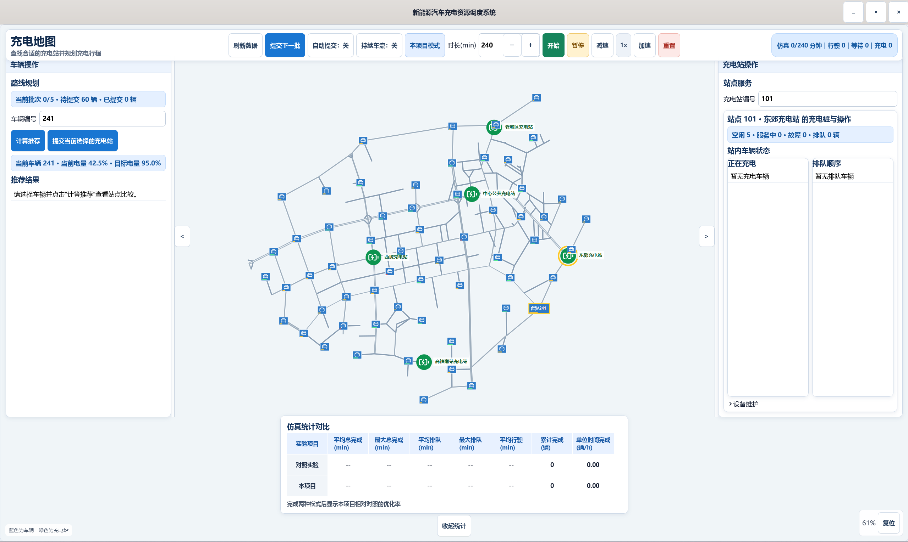
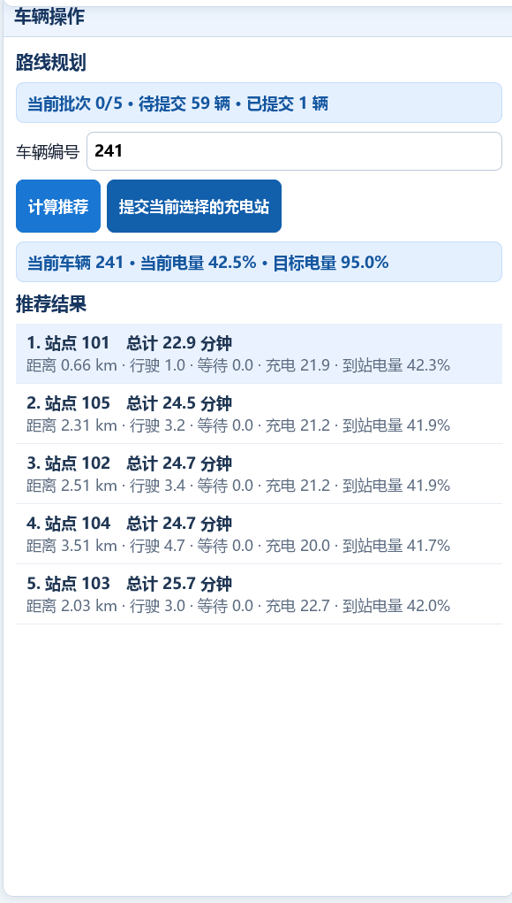
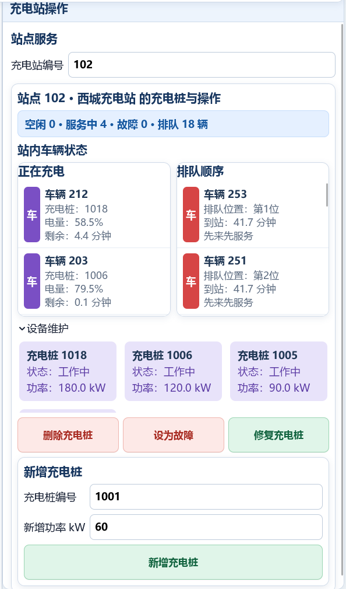
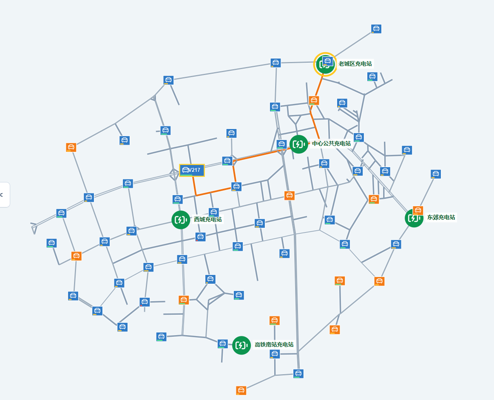
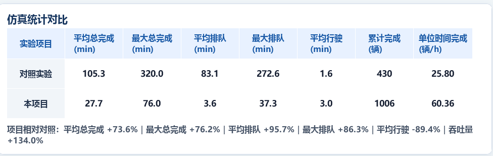

# 城市新能源汽车充电资源调度仿真系统

> 用 **C11 + GTK 4** 构建的可视化充电调度实验平台：让图、堆、哈希表和链表真正参与路径规划、排队调度与离散时间仿真。

系统在可交互路网上模拟车辆提交请求、行驶、排队、充电以及设备故障与恢复，并实时对比“**综合推荐 + 动态优先级**”和“**最近站点 + 先来先服务**”两种策略。

**关键词：** `C11` · `GTK 4` · `数据结构` · `Dijkstra` · `优先队列` · `离散时间仿真` · `充电站调度`

[🚀 快速开始](#-快速开始) · [✨ 功能亮点](#-功能亮点) · [🧠 算法与数据结构](#-算法与数据结构) · [📊 对照实验](#-对照实验) · [🧩 模块说明](#-模块说明) · [🧪 测试](#-测试)

<p align="center">
  
</p>

<p align="center"><sub>交互式路网、车辆与充电站操作、仿真控制和统计对比集中在同一桌面界面中</sub></p>

---

## 🎯 为什么值得一看

这不是把若干算法简单拼在一起的课堂示例，而是一个具有**完整业务流程、动态状态变化、资源竞争和可视化交互**的 C 语言项目。

| 如果你是…… | 可以从项目中获得什么 |
| --- | --- |
| **C 语言、数据结构或程序设计课程的学生** | 在一个完整项目中实践模块化设计、动态内存、文件读写、图、堆、哈希表、链表和单元测试 |
| **正在学习 GTK 4 桌面开发的人** | 参考窗口布局、自定义地图绘制、缩放拖动、响应式侧栏、控件事件、定时器和实时状态刷新 |
| **想了解仿真、充电调度和路径规划的人** | 沿着请求、推荐、行驶、排队、充电和完成的全过程理解多个算法如何协同工作 |
| **需要可继续扩展的调度实验框架的人** | 替换推荐公式、增加调度算法、扩充指标、导入新路网，或加入新的交通与能源约束 |

> [!TIP]
> 项目特别适合用于数据结构综合实践、C 语言课程设计、GTK 4 入门以及调度算法对照实验。

## ✨ 功能亮点

### 🚗 完整的车辆充电流程

- **请求调度：** 支持单车提交、分批提交、每 10 个仿真分钟自动提交和持续车流。
- **路径行驶：** 在有向加权路网上计算路径，并在地图中动态显示车辆行驶过程。
- **站内服务：** 模拟到站、排队、分配充电桩、充电完成和资源释放。
- **设备维护：** 支持新增、删除、故障和修复充电桩。

### 🧭 可解释的推荐与调度

- **路径规划：** 使用 Dijkstra 计算车辆到候选充电站的最短通行时间。
- **综合推荐：** 同时考虑行驶时间、预计等待时间、预计充电时间和低电量风险。
- **动态排队：** 使用二叉最大堆维护优先级，并随等待时间更新调度次序。
- **对照策略：** 提供最近站点推荐和先来先服务队列，便于量化比较。

### 🖥️ GTK 4 可视化界面

- **交互地图：** 支持缩放、拖动、车辆与充电站选择以及路线显示。
- **双侧操作栏：** 左侧管理车辆，右侧管理充电站和充电桩，可折叠、可调宽度。
- **仿真控制：** 可设置运行速度、仿真时长、实验模式和自动提交方式。
- **实时统计：** 在底部表格同步展示两个实验模式的关键指标。

## 🖼️ 界面预览

### 车辆推荐与充电站管理

<table>
  <tr>
    <td width="50%" align="center">
      <br>
      <sub>根据行驶、等待和充电时间生成可选择的站点推荐</sub>
    </td>
    <td width="50%" align="center">
      <br>
      <sub>查看充电与排队车辆，并维护站内充电桩</sub>
    </td>
  </tr>
</table>

### 仿真控制与路线动画

<p align="center">
  
</p>

<p align="center"><sub>批次提交、持续车流、实验模式、仿真时长和运行速度控制</sub></p>

<p align="center">
  
</p>

<p align="center"><sub>橙色路径展示已提交车辆的实时行驶路线和当前位置</sub></p>

### 实验统计对比

<p align="center">
  
</p>

<p align="center"><sub>使用完成时间、排队时间、行驶时间和吞吐量量化两种策略的差异</sub></p>

## 🚀 快速开始

### Windows：使用项目脚本

项目使用 C11 和 GTK 4，Windows 脚本默认从 `C:\msys64\ucrt64\bin` 加载工具链和运行库。

在 [MSYS2 UCRT64](https://www.msys2.org/) 环境安装依赖：

```bash
pacman -S --needed mingw-w64-ucrt-x86_64-toolchain \
  mingw-w64-ucrt-x86_64-gtk4 \
  mingw-w64-ucrt-x86_64-pkgconf make
```

然后在项目根目录执行：

```bat
构建GTK4.bat --no-pause
启动GTK4.bat
```

生成的程序位于 `build/charging_system_gtk4.exe`。

### GNU Make

```bash
make          # 构建 GTK 前端和命令行演示程序
make gui      # 只构建 GTK 前端
make test     # 构建并运行全部测试
make clean    # 删除 Makefile 管理的编译产物
```

> [!IMPORTANT]
> 请以项目根目录作为程序的当前工作目录，否则程序无法通过相对路径找到输入数据和地图图标。

## 📖 基本使用

1. 启动程序，系统自动加载 `data/input` 中的五个 CSV 文件。
2. 在左侧输入编号或点击地图选择车辆，计算充电站推荐结果。
3. 选择目标站点后提交车辆，也可使用“提交下一批”或自动提交。
4. 点击“开始”启动仿真时钟；开始仿真与提交车辆相互独立。
5. 在顶部设置实验模式、持续车流、仿真时长和运行速度。
6. 在右侧查看站内队列、充电状态并维护充电桩。
7. 在底部统计表观察两种实验策略的实时结果。

## 🧠 算法与数据结构

| 解决的问题 | 采用的实现 | 在系统中的作用 |
| --- | --- | --- |
| 道路网络 | 邻接表、带权有向图、道路等级 | 保存路网并支持高效遍历 |
| 路径规划 | Dijkstra、二叉最小堆、前驱恢复 | 计算车辆到充电站的最短通行路径 |
| 排队调度 | 二叉最大堆、动态优先级 | 优先服务低电量或等待较久的车辆 |
| 实体查询 | 拉链哈希表、编号数组 | 快速定位车辆和充电站 |
| 充电桩管理 | 单链表 | 动态新增、删除和更新设备状态 |
| 仿真推进 | 固定时间步、GTK 周期定时器 | 推动车辆行驶、排队和充电状态变化 |
| 数据交换 | CSV 原子加载与状态保存 | 让路网和实验对象可以独立更换 |

动态优先级计算：

```text
优先级 = 紧急程度 × 30
       + (100 - 当前电量百分比) × 0.5
       + 等待时间 × 0.2
```

充电站推荐评分：

```text
总时间 = 行驶时间 + 预计等待时间 + 预计充电时间
评分   = 总时间 + 低电量风险分
```

## 🔄 系统流程


```text
空闲 → 前往充电站 → 排队 → 充电 → 完成
```

## 📊 对照实验

系统允许两种策略分别运行，使用相同类型的仿真过程生成统计结果。

| 实验模式 | 充电站选择 | 站内排队策略 |
| --- | --- | --- |
| **本项目模式** | 综合行驶、排队、充电和低电量风险评分 | 动态优先级队列 |
| **对照实验模式** | 选择行驶时间最近的有效站点 | 先来先服务 |

实时统计指标包括：

- **总完成时间：** 平均值、最大值；
- **排队时间：** 平均值、最大值；
- **行驶时间：** 平均值；
- **吞吐能力：** 累计完成车辆数、单位时间完成车辆数。

## 🧩 模块说明

| 模块 | 目录 | 主要职责 |
| --- | --- | --- |
| 程序入口 | [`src/app`](src/app/README.md) | 命令行演示程序和整体调用流程 |
| 公共模型 | [`src/common`](src/common/README.md) | 状态枚举、核心实体和容量限制 |
| 图与路径 | [`src/module1_graph`](src/module1_graph/README.md) | 图、道路管理、Dijkstra 和路径恢复 |
| 排队调度 | [`src/module2_scheduler`](src/module2_scheduler/README.md) | 动态优先级最大堆和等待时间估算 |
| 实体管理 | [`src/module3_entity`](src/module3_entity/README.md) | 哈希索引和实体生命周期管理 |
| 设备管理 | [`src/module4_charger`](src/module4_charger/README.md) | 充电桩链表、分配、更新和释放 |
| 站点推荐 | [`src/module5_recommend`](src/module5_recommend/README.md) | 候选过滤、评分和排序 |
| 业务仿真 | [`src/module6_simulation`](src/module6_simulation/README.md) | 固定时间步业务仿真 |
| 文件读写 | [`src/module7_fileio`](src/module7_fileio/README.md) | CSV 加载、校验和保存 |
| GTK 界面 | [`src/module8_ui`](src/module8_ui/README.md) | 地图、交互界面和实验功能 |
| 定时控制 | [`src/module9_timer`](src/module9_timer/README.md) | GTK 定时器和动画时间累计 |

每个模块目录均提供独立 README，介绍功能、核心结构、公开函数、实现流程和使用约束。

## 🗺️ 示例数据

示例数据位于 [`data/input`](data/README.md)：

| 数据 | 当前规模 |
| --- | ---: |
| 图节点 | 305 个：240 个道路节点、60 个车辆起点、5 个充电站入口 |
| 道路记录 | 442 条 |
| 车辆 | 60 辆，分布在 60 个不同位置 |
| 充电站 | 5 个 |
| 充电桩 | 24 个，每站 4～6 个，功率为 60、90、120 或 180 kW |

这些数据用于课程设计仿真，仅表达相对路网关系，不代表现实导航或实时交通数据。

## 📁 目录结构

```text
.
├─ assets/                   地图图标及第三方资源许可
├─ build/                    编译输出
├─ data/
│  ├─ input/                仿真输入 CSV
│  └─ output/               程序和测试输出
├─ src/
│  ├─ app/                  命令行入口
│  ├─ common/               公共数据模型
│  ├─ module1_graph/        路网与路径算法
│  ├─ module2_scheduler/    排队调度
│  ├─ module3_entity/       实体管理
│  ├─ module4_charger/      充电桩管理
│  ├─ module5_recommend/    站点推荐
│  ├─ module6_simulation/   业务仿真
│  ├─ module7_fileio/       CSV 文件读写
│  ├─ module8_ui/           GTK 4 前端
│  └─ module9_timer/        GTK 定时控制
├─ tests/                    单元测试和整体联调测试
├─ Makefile                  GNU Make 构建规则
├─ 构建GTK4.bat             Windows GTK 前端构建脚本
└─ 启动GTK4.bat             Windows 启动脚本
```

## 🧪 测试

测试覆盖图、调度器、实体、充电桩、推荐、仿真、文件读写、定时器和完整后端流程。测试说明见 [`tests/README.md`](tests/README.md)。

```bash
make test
```

## 🔧 可以继续扩展什么

- 加入道路拥堵、动态通行时间或道路临时关闭；
- 加入预约充电、分时电价和充电费用优化；
- 比较更多推荐、排队和全局调度算法；
- 增加车辆类型、电池衰减和不同充电曲线；
- 导入更大规模的路网和实验数据；
- 扩展统计指标并导出实验结果。

路网、车辆、站点和充电桩均由 CSV 驱动，输入字段与约束见 [`data/README.md`](data/README.md)。欢迎通过 Issue 讨论想法，也欢迎 Fork 后开展自己的算法实验。

## 📦 第三方资源

车辆和充电站图标来自 Lucide Icons，按照 ISC License 使用。许可证全文位于 [`assets/icons/LUCIDE-LICENSE.txt`](assets/icons/LUCIDE-LICENSE.txt)。

## 📄 开源许可

项目源代码按照 [MIT License](LICENSE) 开源，第三方资源仍遵循各自的许可证。

如果这个项目对你的学习或课程实践有帮助，欢迎 **Star、Fork 或提出建议**。
